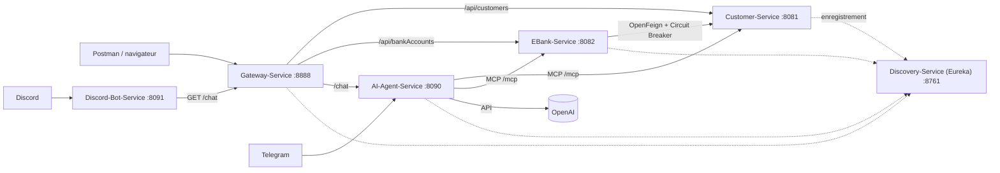
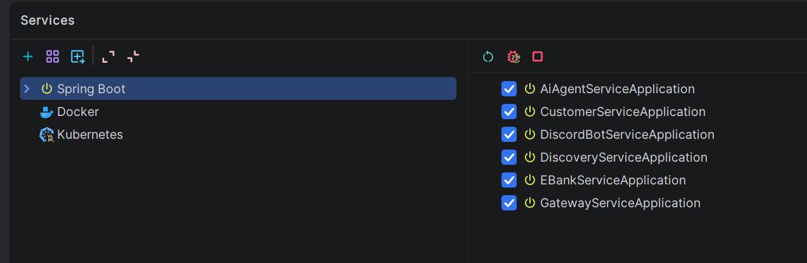
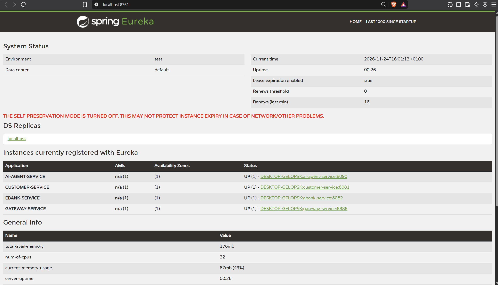
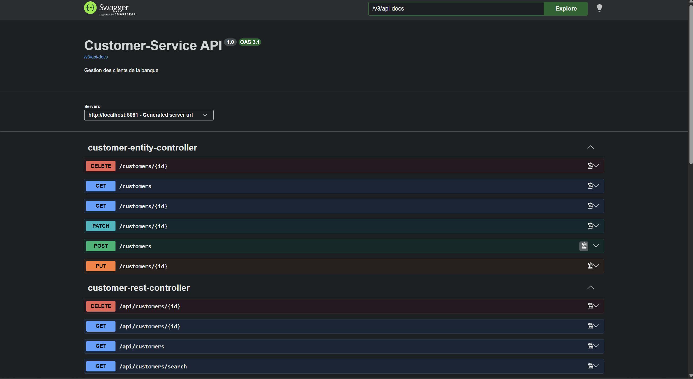
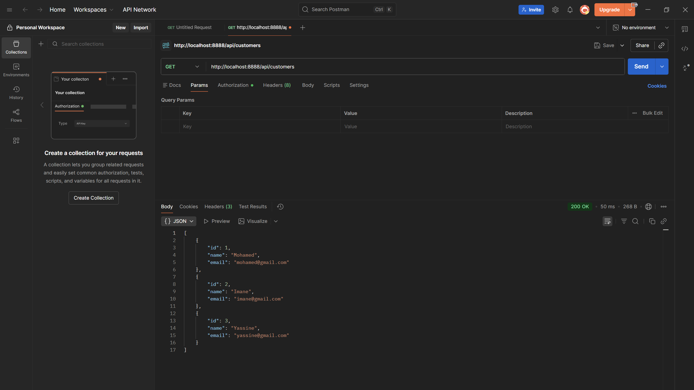
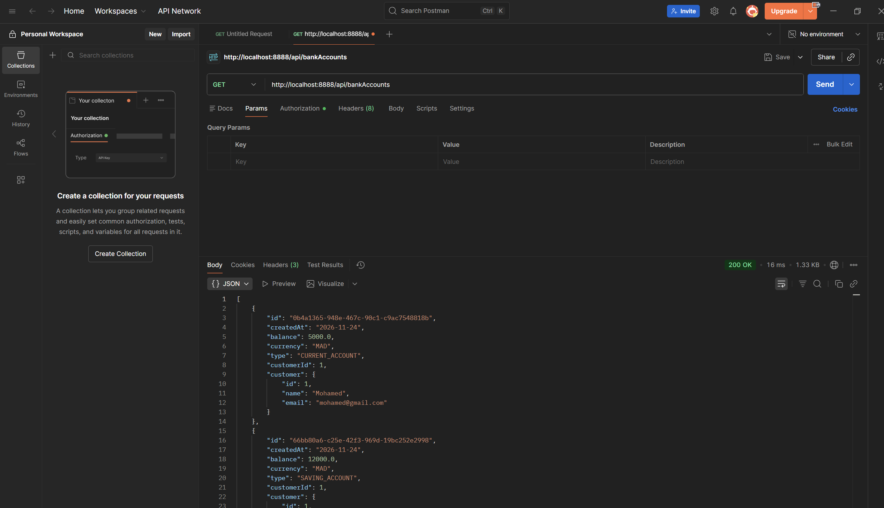
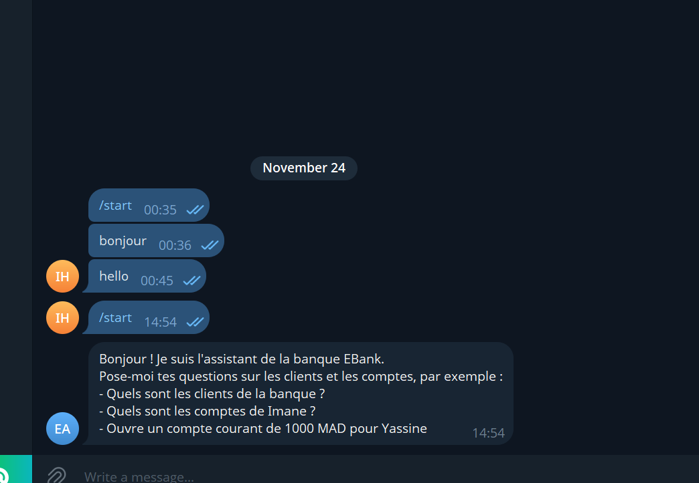
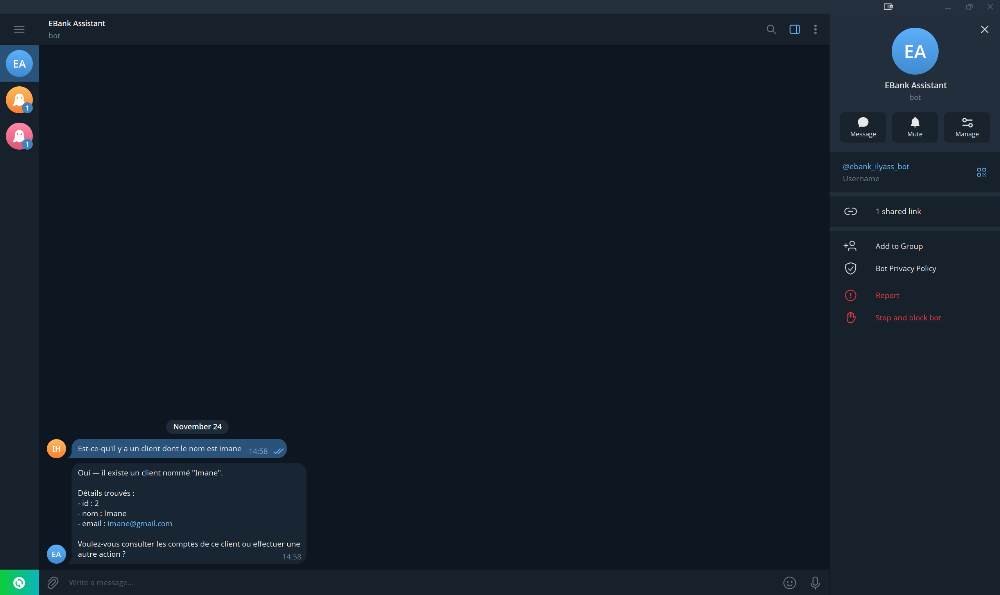

# EBank — Architecture micro-services et agent IA

Projet « Microservices and Agentic Architecture Project » (Pr Mohamed Youssfi, EMSI), réalisé par Ilyass Hakim.

Une petite banque en ligne découpée en micro-services Spring Cloud (clients, comptes, Gateway, Discovery), puis exposée à un agent IA Spring AI par le protocole MCP. L'agent répond en langage naturel par une API REST, sur Telegram et sur Discord.

## Sommaire

- [Architecture](#architecture)
- [Services](#services)
- [Technologies](#technologies)
- [Partie 1 : micro-services](#partie-1--micro-services)
- [Partie 2 : agent IA et MCP](#partie-2--agent-ia-et-mcp)
- [Lancement](#lancement)
- [Tests](#tests)
- [Démo (captures d'écran)](#démo-captures-décran)

## Architecture

- Chaque service s'enregistre dans **Eureka** ; la Gateway et OpenFeign y trouvent l'adresse réelle des services (`lb://nom-du-service`).
- **EBank-Service** récupère les clients de Customer-Service avec **OpenFeign**, protégé par un **Circuit Breaker Resilience4J**.
- **Customer-Service** et **EBank-Service** exposent leurs fonctionnalités comme outils **MCP**. L'**agent IA** s'y connecte comme client MCP et choisit lui-même les outils à appeler.

## Services

| Service | Port | Rôle |
|---|---|---|
| `Discovery-Service` | 8761 | Annuaire Eureka : chaque service s'y enregistre |
| `Gateway-Service` | 8888 | Point d'entrée unique (Spring Cloud Gateway) : routes déclarées et routes dynamiques |
| `Customer-Service` | 8081 | Gestion des clients (JPA + H2), API REST, Spring Data REST, Swagger, serveur MCP |
| `EBank-Service` | 8082 | Gestion des comptes bancaires, appel de Customer-Service par OpenFeign, Circuit Breaker, Swagger, serveur MCP |
| `AI-Agent-Service` | 8090 | Agent Spring AI (OpenAI) avec client MCP et mémoire de conversation ; endpoint `/chat` et bot Telegram |
| `Discord-Bot-Service` | 8091 | Bot Discord qui transmet les messages à l'agent par la Gateway |

## Technologies

- Java 21, Maven (wrapper `mvnw` dans chaque module)
- Spring Boot 4.1.1, Spring Data JPA, Spring Data REST, H2
- Spring Cloud 2025.1.3 : Netflix Eureka, Gateway, OpenFeign, Circuit Breaker Resilience4J
- springdoc-openapi 3.1.1 (Swagger UI)
- Spring AI 2.0.2 : OpenAI, serveur et client MCP (Streamable HTTP), mémoire de conversation
- TelegramBots 10.3.0, JDA 6.7.0 (Discord)

## Partie 1 : micro-services

### Customer-Service

| Méthode | URL | Description |
|---|---|---|
| `GET` | `/api/customers` | Liste des clients |
| `GET` | `/api/customers/{id}` | Un client |
| `GET` | `/api/customers/search?keyword=ima` | Recherche par nom |
| `POST` | `/api/customers` | Créer un client |
| `PUT` | `/api/customers/{id}` | Modifier un client |
| `DELETE` | `/api/customers/{id}` | Supprimer un client |

Spring Data REST expose aussi `/customers`. Trois clients sont créés au démarrage : Mohamed, Imane et Yassine.

### EBank-Service

| Méthode | URL | Description |
|---|---|---|
| `GET` | `/api/bankAccounts` | Liste des comptes, chacun avec son client (OpenFeign) |
| `GET` | `/api/bankAccounts/{id}` | Un compte |
| `GET` | `/api/bankAccounts/customer/{customerId}` | Les comptes d'un client |
| `POST` | `/api/bankAccounts` | Créer un compte (le client doit exister) |
| `PUT` | `/api/bankAccounts/{id}` | Modifier un compte |
| `DELETE` | `/api/bankAccounts/{id}` | Supprimer un compte |

Spring Data REST expose aussi `/bankAccounts`.

### OpenFeign et Circuit Breaker

- Le client OpenFeign est `EBank-Service/.../clients/CustomerRestClient.java` (`@FeignClient(name = "customer-service")`).
- Chaque appel passe par un disjoncteur Resilience4J (`config/CircuitBreakerConfiguration.java`) :
  - décision sur les 10 derniers appels, au moins 5 appels ;
  - ouverture à partir de 50 % d'échecs, pendant 10 s ;
  - un appel de plus de 3 s compte comme un échec ;
  - un 404 (client inexistant) n'est pas une panne.
- Si Customer-Service est arrêté, le fallback (`CustomerRestClientFallbackFactory`) renvoie un client « Not available » : la liste des comptes reste disponible. La création d'un compte est refusée avec un 503, car le client ne peut pas être vérifié.

### Gateway et Discovery

- Routes déclarées : `http://localhost:8888/api/customers`, `http://localhost:8888/api/bankAccounts`, `http://localhost:8888/chat`.
- Routes dynamiques, créées pour chaque service d'Eureka : `http://localhost:8888/customer-service/api/customers`, `http://localhost:8888/ebank-service/api/bankAccounts`.
- Tableau de bord Eureka : http://localhost:8761

### Swagger UI

- Customer-Service : http://localhost:8081/swagger-ui.html
- EBank-Service : http://localhost:8082/swagger-ui.html

## Partie 2 : agent IA et MCP

### Serveurs MCP

Customer-Service et EBank-Service exposent des outils MCP (`@McpTool`) en Streamable HTTP :

| Serveur | URL | Outils |
|---|---|---|
| `customer-mcp-server` | http://localhost:8081/mcp | `getAllCustomers`, `getCustomerById`, `searchCustomers`, `createCustomer` |
| `ebank-mcp-server` | http://localhost:8082/mcp | `getAllBankAccounts`, `getBankAccountById`, `getBankAccountsByCustomer`, `createBankAccount` |

Les tests `CustomerMcpServerTests` et `EBankMcpServerTests` jouent le rôle de client MCP : connexion, liste des outils et appel d'un outil.

### Agent IA (AI-Agent-Service)

- `EbankAiAgent` : un `ChatClient` Spring AI (OpenAI, modèle `gpt-5-mini` par défaut) qui reçoit les outils des deux serveurs MCP et une mémoire de conversation (`MessageChatMemoryAdvisor`).
- API REST : `GET /chat?query=...&conversationId=...`, directement sur le port 8090 ou par la Gateway.
- Exemples :
  - http://localhost:8888/chat?query=Quels%20sont%20les%20comptes%20de%20Imane%20%3F
  - http://localhost:8888/chat?query=Ouvre%20un%20compte%20courant%20de%201000%20MAD%20pour%20Yassine

### Chatbots Telegram et Discord

- **Telegram** (`@ebank_ilyass_bot`) : intégré à AI-Agent-Service (long polling). `/start` affiche l'accueil ; chaque chat Telegram a sa propre mémoire.
- **Discord** : service séparé `Discord-Bot-Service`. Le bot répond aux messages privés et quand on le mentionne dans un salon ; il appelle l'agent par la Gateway.

## Lancement

### Prérequis

- JDK 21
- Une clé API OpenAI ; un token de bot Telegram (BotFather) et un token de bot Discord pour les chatbots

### Variables d'environnement

Les secrets ne sont jamais dans le dépôt. Dans IntelliJ, les ajouter dans **Run > Edit Configurations… > Environment variables** :

| Application | Variables |
|---|---|
| `AiAgentServiceApplication` | `OPENAI_API_KEY`, `TELEGRAM_BOT_TOKEN` (optionnel) |
| `DiscordBotServiceApplication` | `DISCORD_BOT_TOKEN` |

Sans `TELEGRAM_BOT_TOKEN` ou `DISCORD_BOT_TOKEN`, le bot correspondant ne démarre pas ; le reste fonctionne.

### Ordre de démarrage

1. `DiscoveryServiceApplication` (8761)
2. `CustomerServiceApplication` (8081)
3. `EBankServiceApplication` (8082)
4. `AiAgentServiceApplication` (8090)
5. `GatewayServiceApplication` (8888)
6. `DiscordBotServiceApplication` (8091)

L'agent se connecte aux serveurs MCP au démarrage : si Customer-Service ou EBank-Service est relancé, relancer l'agent ensuite.

En ligne de commande, dans le dossier de chaque module : `./mvnw spring-boot:run`.

## Tests

- Tests automatiques de tous les modules : `run-all-tests.cmd` à la racine (résultat dans `test-results.log`), ou `./mvnw test` dans un module.
- Collection Postman : `postman/EBank-Microservices.postman_collection.json` (clients, comptes, Spring Data REST, Gateway et Discovery, Circuit Breaker, agent IA).

## Démo (captures d'écran)

### 1. Les 6 micro-services lancés dans IntelliJ

### 2. Eureka : services enregistrés

AI-AGENT-SERVICE, CUSTOMER-SERVICE, EBANK-SERVICE et GATEWAY-SERVICE sont UP.

### 3. Swagger UI de Customer-Service

API REST (`customer-rest-controller`) et API Spring Data REST (`customer-entity-controller`).

### 4. Gateway vers Customer-Service (Postman)

`GET http://localhost:8888/api/customers` : la Gateway trouve Customer-Service dans Eureka.

### 5. Gateway vers EBank-Service, clients récupérés par OpenFeign

`GET http://localhost:8888/api/bankAccounts` : chaque compte contient son client, récupéré auprès de Customer-Service par OpenFeign.

### 6. Bot Telegram : message d'accueil

### 7. Bot Telegram : question à l'agent IA

L'agent comprend la question, appelle les outils MCP de Customer-Service et répond avec les données réelles de la base.

